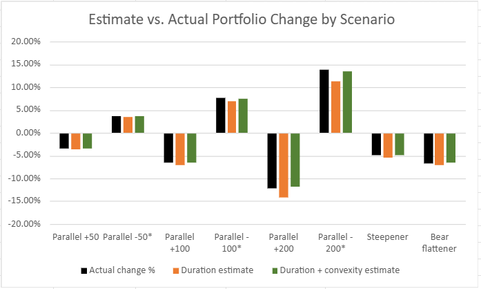
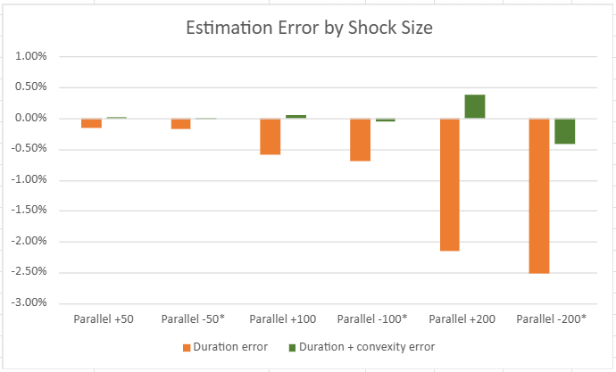
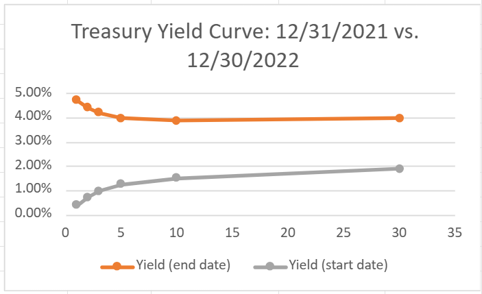

# Bond Portfolio Interest Rate Risk in Excel: Duration vs. Convexity

This Excel project measures how much a Treasury bond portfolio's value changes when interest rates move, and how well duration and convexity predict that change. I tested nine rate scenarios, then backtested the portfolio against 2022, when rates rose sharply.

[Download the Excel workbook](Bond_Portfolio_Risk_Model.xlsx)

**Data**

I retrieved the daily Treasury constant-maturity yields from [FRED](https://fred.stlouisfed.org/series/DGS10) for the 1, 2, 3, 5, 10, and 30-year maturities (DGS1 to DGS30), from 11/1/2021 to 10/30/2026.

**Method**

<ins>Portfolio</ins>

I created six hypothetical Treasuries as of 12/31/2021, maturing in 1, 2, 3, 5, 10, and 30 years, each with \$1,000,000 face value. I then set each coupon to that day's market yield, so every bond starts at par. I priced the 10-year by hand to check Excel's PRICE and MDURATION results, and calculated convexity by repricing each bond at ±1 basis point (bp). The portfolio's modified duration was found to be 7.13.

<ins>Scenarios</ins>

Parallel shifts of ±50, ±100, and ±200 bp, plus a steepener (for when long rates rise more) and a bear flattener (for when short rates rise more). I compared the actual price change with the duration estimate and the duration + convexity estimate for each scenario, and floored yields at 0%.

<ins>Backtest</ins>

I held the portfolio through 12/30/2022. Since each bond was a year closer to maturity, I estimated its end yield from the two nearest points on the 2022 yield curve, then compared the actual price change with both estimates.

**Results**

| Scenario        |  Actual | Duration | Duration + convexity |
|-----------------|--------:|---------:|---------------------:|
| Parallel +100   |  -6.55% |   -7.13% |               -6.50% |
| Parallel +200   | -12.10% |  -14.26% |              -11.72% |
| Parallel -200\* | +13.88% |  +11.36% |              +13.46% |
| Steepener       |  -4.89% |   -5.41% |               -4.84% |
| Bear flattener  |  -6.63% |   -7.04% |               -6.60% |

\*Yields floored at 0%, so short bonds moved less than the stated shift. All nine scenarios are in the workbook.

Duration’s error grows roughly with the square of the rate move, from 0.58 points at +100 bp to 2.16 points at +200 bp, while adding convexity keeps the error small. Most of that risk comes from the 30-year bond, which drove about half the portfolio’s loss in the +100 bp scenario. Where on the curve rates move matters too: the steepener lost more than a parallel 50 bp rise, because its biggest moves hit the long bonds.

In 2022, yields rose by 207 to 434 bp and the curve nearly inverted. The portfolio's price fell 12.36% (total return -11.23% with coupons, about -\$674,000), close to my +200 bp stress test. Both estimates overstated the loss (duration by 5.2 points, duration + convexity by 2.1) since they don't account for bonds getting shorter over the year. The 1-year bond was predicted to lose 4.3% but lost almost nothing, as it was one day from maturity.

**Findings**

Although duration works well for small rate moves and convexity fixes most of its error for large ones, both overstate the loss over a period as long as a year. For big moves or long periods, it’s better to fully reprice the bonds.

**Files**

- `Bond_Portfolio_Risk_Model.xlsx`: the full workbook (inputs, data, pricing, scenarios, backtest, and summary)
- `README.md`: this page
- `estimate_vs_actual.png`, `error_by_shock.png`, `yield_curve.png`: charts used in the report

**Limitations**

The bonds are hypothetical par Treasuries (no credit risk), and the scenario shocks are instant, which is a standard stress test rather than a realistic forecast. In the backtest, I estimated yields for maturities FRED doesn’t publish (like 9 years) by drawing a straight line between the nearest ones, so those prices are close estimates. The results also cover only one portfolio and one backtest year of 2022, which saw one of the fastest rate increases in decades.
